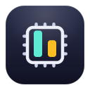

<p align="center">
  
</p>

<h1 align="center">stats-lite</h1>

[](https://github.com/timwuhaotian/stats-lite/actions/workflows/ci.yml)
[](LICENSE)


CPU and disk usage in the macOS menu bar, and nothing else. No settings, no charts,
no dock icon: a `cpu` icon with the CPU %, an `internaldrive` icon with the used %
of the `/` volume. Numbers are monospaced and right-aligned, so neighbouring icons
never bounce as values change.

An idle machine costs nothing: CPU is sampled every 2 s (disk every 60 s), and the
title is only rewritten when a number changes, so there are no WindowServer redraws
at rest. (1 s polling is what made Stats burn 59% CPU watching an idle machine.)

## Install

Download [`StatsLite-arm64.dmg`](https://github.com/timwuhaotian/stats-lite/raw/main/releases/StatsLite-arm64.dmg),
always the latest stats-lite, open it, and drag **StatsLite** to **Applications**.
The app is signed with a Developer ID and notarized by Apple. From then on it keeps
itself up to date: a new release is checked at launch and every six hours,
downloads in the background, and installs when you quit — or right away with
**Restart to Update** from the menu.

## Build from source

You need a Mac with Apple silicon and Rust 1.94 or later.

```sh
git clone https://github.com/timwuhaotian/stats-lite.git
cd stats-lite
cargo run --release
```

For a `StatsLite.app` with its Info.plist, installed as a login item candidate:

```sh
scripts/bundle.sh release            # → target/release/StatsLite.app (ad-hoc signed)
ditto target/release/StatsLite.app /Applications/StatsLite.app
```

`bundle.sh debug` builds a debug bundle instead.

## Using it

- The menu-bar title reads e.g. `[cpu] 12%  [drive] 34%`: CPU usage and used %
  of the `/` volume. A volume that can't be read shows `—`, never `0%`.
- Hovering (or VoiceOver) gives the words: `stats-lite: CPU 12%, disk 34%`.
- **Check for Updates…** opens a window with live progress and the result; a
  downloaded update can be installed with **Restart Now**. **Quit stats-lite** (`⌘Q`)
  also installs an update that is ready.

## How it works

- [`sysinfo`](https://github.com/GuillaumeGomez/sysinfo) samples CPU (2 s cadence)
  and disk (every 60 s). CPU % is a delta between two samples, so one is taken
  before the UI even exists.
- [`objc2`](https://github.com/madsmtm/objc2) owns a variable-length `NSStatusItem`;
  the title is an attributed string with SF Symbol attachments, rebuilt only when
  a number changes.
- `LSUIElement` keeps it out of the dock; `NSAppSleepDisabled` keeps the cadence;
  sudden termination loses nothing, so both are declared.

## Contributing and releases

Bug reports and fixes are welcome; see [`CONTRIBUTING.md`](CONTRIBUTING.md).
Releases are version bumps built locally by the maintainer ([`RELEASING.md`](RELEASING.md)).
